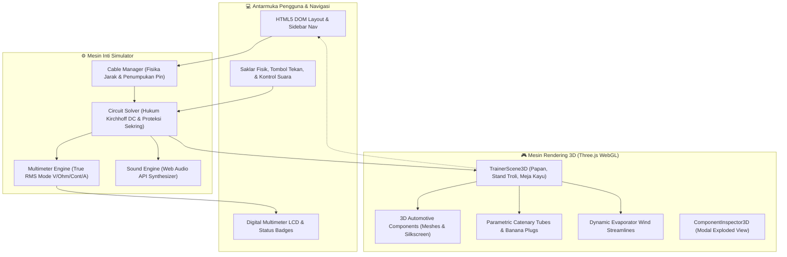

# ⚡ Wiroto Labs — Virtual Automotive Electrical & AC 3D Simulator

<p align="center">
  
</p>

<p align="center">
  <b>Platform Simulator Trainer Kelistrikan Bodi Otomotif &amp; Sistem AC Mobil (R134a) 3D Interaktif</b><br>
  <i>Dirancang khusus untuk pembelajaran teknik vokasi SMK Teknik Kendaraan Ringan (TKR) dan Pendidikan Teknik Otomotif.</i>
</p>

<p align="center">
  
  
  
  
  
  
</p>

---

## 📖 Tentang Wiroto Labs

**Wiroto Labs** adalah media pembelajaran praktikum virtual otomotif berbasis web 3D yang menghadirkan pengalaman merangkai kabel (*wiring harness*) trainer fisik secara nyata ke dalam browser tanpa memerlukan instalasi aplikasi berat.

Dikembangkan berdasarkan standar kurikulum **Teknik Kendaraan Ringan (TKR)**, simulator ini mereplikasi secara presisi meja trainer bengkel sekolah, lengkap dengan rak kabel gantung, aki 12V independen, multimeter digital interaktif, mekanik penumpukan colokan (*stackable banana plug*), batas panjang fisik kabel (10 cm, 20 cm, 30 cm, 50 cm), serta pemutus sekring otomatis saat terjadi hubung singkat (*short circuit*).

---

## 🌟 Fitur Unggulan

### 1. 🎛️ Fisika Kabel Nyata & Stackable Banana Plug
- **Batas Jangkauan Kabel Fisik:** Siswa memilih ukuran panjang kabel (**10 cm**, **20 cm**, **30 cm**, **50 cm**, dan **Kabel Jepit Buaya Aki**). Jika jarak antar-pin melebihi batas panjang kabel, simulator akan menolak koneksi dan memberi tahu jarak aktual dalam satuan sentimeter.
- **Mekanik Penumpukan Pin (*Stacking*):** Meniru soket banana plug nyata di bengkel. Siswa dapat menumpuk beberapa colokan kabel pada terminal perantara yang sama (misalnya terminal 30 atau terminal massa 31) untuk mencabangkan arus listrik.
- **Lengkungan Alami Gravitasi (*Catenary Sag*):** Kabel digantung menggunakan kurva *Catmull-Rom* parametrik yang melengkung secara fleksibel dan rapi di depan papan tanpa pernah menembus meja atau instrumen trainer.

### 2. ⚡ Solver Sirkuit DC Real-Time & Efek Suara Dinamis
- **Simulasi Aliran Arus 12V DC Presisi:** Menghitung jatuh tegangan (*voltage drop*), hambatan resistor blower, aktivasi koil relay elektromagnetik, dan interlock pengaman secara deterministik.
- **Proteksi Hubung Singkat (*Short Circuit Protection*):** Jika kutub positif baterai dihubungkan langsung ke massa tanpa melewati beban, sekring (*fuse*) seketika putus disertai percikan api partikel 3D dan suara *"cetek"*.
- **Mesin Suara Audio Sintesis (Web Audio API):** Dilengkapi efek suara klakson kendaraan, *clicking* relay, *ticking* flasher sein, putaran dinamis blower AC berkecepatan 3-tingkat, dan klik magnetik *clutch* kompresor tanpa ketergantungan aset audio eksternal.

### 3. 📟 Digital Multimeter Terintegrasi (CAT III 600V True RMS)
- Mengukur tegangan DC (**DC V**), resistansi (**Ohm**), uji kontinuitas bel dengung (**Continuity Buzzer**), dan arus (**DC A**).
- Dilengkapi kabel probe Merah (+) dan Hitam (COM) yang dapat ditancapkan ke pin terminal mana pun pada papan atau aki, dengan tampilan layar LCD digital presisi serta unit fisik 3D di atas meja.

### 4. ❄️ Trainer Sistem AC Mobil Lengkap (R134a)
- **Siklus Refrigerasi Terintegrasi:** Mensimulasikan kompresor AC berpuli, magnetic clutch, kondensor & kipas ekstra (*extra fan*), receiver-drier dengan kaca pengintai (*sight glass*), katup ekspansi, dan evaporator louvered 4-ventilasi.
- **Dual Manifold Gauge:** Menampilkan tekanan sisi rendah (*Low Pressure*) dan sisi tinggi (*High Pressure*) yang bergerak secara proporsional sesuai status kerja siklus refrigerasi.
- **Termometer Digital 3-Titik:** Menampilkan suhu *Ambient* (T1), *Evaporator Inlet* (T2), dan hembusan ventilasi kabin *Vent Discharge* (T3) yang mendingin secara otomatis saat AC aktif.
- **Simulasi Hembusan Angin Dinamis:** Garis angin aerodinamis tipis bergelombang pada sirip evaporator yang meningkat frekuensi dan kecepatannya mengikuti posisi saklar blower (1 - 2 - 3).

### 5. 🔍 3D Component Inspector & Exploded View
- Buka dan amati struktur internal komponen secara terpisah (Headlamp reflektor fluted, Relay transparan, Motor penggerak, dsb.).
- Fitur *Exploded View* mengangkat seluruh rumah komponen 3D ke depan sumbu Z secara halus untuk memudahkan observasi arsitektur terminal di balik panel.

---

## 📚 10 Modul Praktikum Kurikulum Terstandar

| Modul | Kategori | Topik Praktikum | Standar Kompetensi |
| :---: | :--- | :--- | :--- |
| **FIG. 00** | 1. Dasar Kelistrikan | **Dasar Kelistrikan & Multimeter** | Pengenalan polaritas aki 12V, pengukuran tegangan, hukum Ohm pada lampu, dan uji kontinuitas buzzer. |
| **FIG. 01** | 2. Kelistrikan Bodi | **Sekring & Beban Tunggal** | Rangkaian pengaman sekring (blade fuse), saklar kontak, dan beban tunggal dengan proteksi arus lebih. |
| **FIG. 02** | 2. Kelistrikan Bodi | **Relay 4-Kaki & Klakson** | Prinsip kerja relay elektromagnetik (`30-85-86-87`), kontrol saklar arus rendah, dan aktivasi klakson. |
| **FIG. 03** | 2. Kelistrikan Bodi | **Lampu Kota & Lampu Rem** | Rangkaian lampu clearance/tail parallel ganda serta saklar pedal rem sesaat (*momentary brake switch*). |
| **FIG. 04** | 2. Kelistrikan Bodi | **Lampu Kepala (Low & High Beam)** | Sistem lampu utama jauh/dekat dengan saklar kombinasi dimmer dan proteksi *dual relay*. |
| **FIG. 05** | 2. Kelistrikan Bodi | **Lampu Sein & Lampu Hazard** | Rangkaian pengedip otomatis (*flasher* terminal `B-L-E`), saklar 3-arah kiri/kanan, dan saklar hazard simultan. |
| **FIG. 06** | 2. Kelistrikan Bodi | **Full Trainer Kelistrikan Bodi** | Pengintegrasian seluruh sistem penerangan dan tanda bodi mobil dalam satu meja kerja utuh. |
| **AC01** | 3. Sistem AC Mobil | **Kelistrikan Blower & Resistor** | Saklar rotary 4-posisi (0-1-2-3), resistor penurun tegangan, dan kecepatan hembusan udara evaporator. |
| **AC02** | 3. Sistem AC Mobil | **Kelistrikan Magnetic Clutch** | Rangkaian interlock saklar AC tekan, pengatur suhu termostat, *dual pressure switch*, dan relay kopling magnet. |
| **AC03** | 3. Sistem AC Mobil | **Full Trainer AC Mobil & Siklus R134a** | Integrasi lengkap kelistrikan kontrol AC, penggerak kompresor, manifold gauge, termometer kabin, dan aliran udara. |

---

## 🏗️ Arsitektur Sistem



---

## 🚀 Cara Menjalankan

### Opsi 1: Akses Online di Browser (Vercel)
Aplikasi telah dioptimalkan untuk berjalan secara statis di Vercel dengan *zero configuration*:
- Cukup hubungkan repositori ini ke akun [Vercel](https://vercel.com/) Anda.
- Simulator langsung aktif di URL produksi Vercel dengan kecepatan penuh 60 FPS.

### Opsi 2: Menjalankan Secara Lokal (Local Dev)
1. **Clone Repositori:**
   ```bash
   git clone https://github.com/maulana-mash/Wiroto-Labs.git
   cd Wiroto-Labs
   ```
2. **Jalankan HTTP Server Lokal (Pilih salah satu):**
   - Menggunakan Python:
     ```bash
     python serve.py
     ```
   - Atau langsung klik ganda `run-browser.bat` di Windows Explorer.
3. Buka browser pada alamat:
   ```text
   http://localhost:8085/
   ```

### Opsi 3: Mode Desktop Mandiri (Windows App)
Klik ganda berkas:
```text
run-webview-app.bat
```
Aplikasi akan langsung berjalan dalam jendela mandiri (*standalone window*) tanpa bilah alamat browser, ideal untuk komputer lab sekolah tanpa koneksi internet.

---

## 🧪 Pengujian Unit (Test Suite)

Repositori ini dilengkapi dengan rangkaian pengujian unit otomatis menggunakan runner bawaan Node.js (`node:test`):

```bash
npm test
```

Hasil verifikasi:
```text
✔ AC Modules (ac01, ac02, ac03) are registered in curriculum category (3.9ms)
✔ ac01 Blower & Resistor: validates speeds 0-1-2-3 voltage drops (4.8ms)
✔ ac02 Magnetic Clutch: validates series safety interlocks (1.3ms)
✔ ac03 Full Trainer AC: integrates Blower, Clutch, Gauges, and Temps (36.4ms)
✔ computePinDistanceCm converts 3D world distance using 2.5 cm per unit (1.4ms)
✔ Cable options support 10, 20, 30, 50 cm with jumper-10 handling short connections (1.7ms)
✔ validateCableConnection rejects cable when distance exceeds selected length (0.3ms)
✔ validateCableConnection requires alligator clip on battery posts (0.3ms)
✔ CableManager supports stacking multiple banana plugs on an intermediate pin (0.9ms)
✔ MODULES defines all required automotive curriculum figures (0.4ms)
✔ CircuitSolver energizes lamp via battery clips, ignition switch, and fuse (5.1ms)
✔ CircuitSolver blows fuse immediately when +12V is wired to GND (0.9ms)
✔ CircuitSolver activates 4-pin relay coil to close contact and sound horn (2.6ms)
✔ All curriculum modules have valid demoWires that pass distance validation (1.8ms)
✔ Fig. 00 12V Basic Electricity & Multimeter Lab simulates Ohm law and Buzzer (9.2ms)
✔ UI files contain zero Unicode emojis and use pure inline SVG icons (35.1ms)
✔ Fig. 06 Full Trainer simulates Horn, High/Low Beam, and Turn/Hazard (7.8ms)

ℹ tests 17 | pass 17 | fail 0 | duration_ms 196ms
```

---

## 🛠️ Tumpukan Teknologi (Tech Stack)

- **3D Graphics Engine:** [Three.js](https://threejs.org/) (r160) WebGL dengan pencahayaan studio, PCF Soft Shadows, dan optimasi *sub-10ms render frame rate*.
- **Camera Controls:** OrbitControls dengan pembatas sudut polar agar kamera tidak menembus lantai atau meja.
- **Audio Synthesis:** Web Audio API (*zero-audio-file dependency*) untuk simulasi suara relay, klakson, flasher, blower, dan kopling magnet.
- **Styling & UI:** CSS3 Custom Properties (Design Tokens), Glassmorphism modern, Tipografi Plus Jakarta Sans & JetBrains Mono, dan ikon inline SVG murni (anti-emoji di antarmuka).
- **Deployment:** Vercel Static Hosting (`vercel.json`) & Windows WebView2 Desktop Runner.

---

## 👥 Kontributor & Lisensi

- **Penyusun & Pengembang:** **Maulana Mash** & Tim Wiroto Labs
- **Institusi/Fokus:** Pendidikan Teknik Otomotif & Vokasi Indonesia
- **Lisensi:** Berlisensi [MIT](LICENSE). Terbuka untuk digunakan di sekolah, kampus, dan pusat pelatihan vokasi secara bebas.
