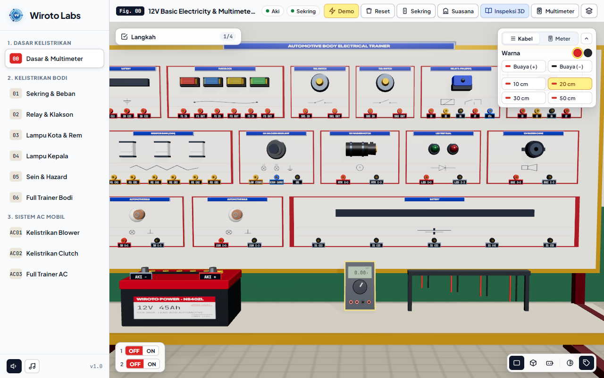
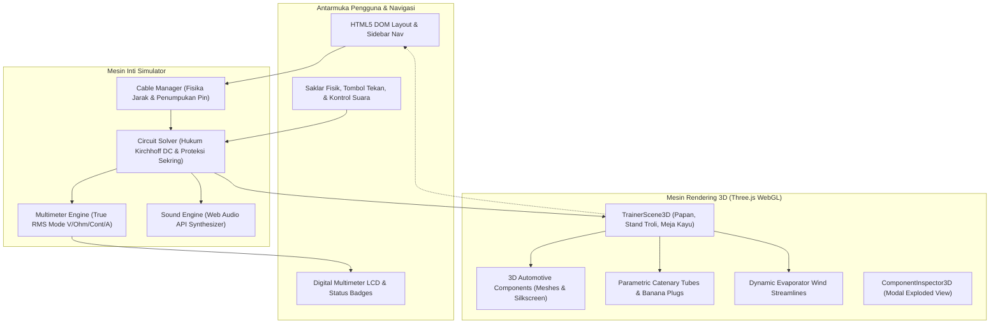

<p align="center">
  <a href="https://github.com/maulana-mash/Wiroto-Labs">
    
  </a>
</p>

<h1 align="center">Wiroto Labs</h1>

<p align="center">
  <strong>Simulator 3D Trainer Kelistrikan Bodi Otomotif &amp; Sistem AC Mobil (R134a)</strong><br />
  Platform praktikum virtual otomotif berbasis Three.js WebGL 60 FPS yang mereplikasi meja trainer bengkel SMK Teknik Kendaraan Ringan (TKR) lengkap dengan fisika kabel nyata, multimeter digital True RMS, proteksi sekring, dan 10 modul kurikulum terstandar.
</p>

<p align="center">
  
  
  
  
  
</p>

<p align="center">
  <a href="#pratinjau-antarmuka">Pratinjau</a> &bull;
  <a href="#fitur-unggulan">Fitur Unggulan</a> &bull;
  <a href="#10-modul-praktikum-kurikulum-terstandar">10 Modul</a> &bull;
  <a href="#arsitektur-sistem">Arsitektur</a> &bull;
  <a href="#cara-menjalankan">Cara Menjalankan</a> &bull;
  <a href="#lisensi">Lisensi</a>
</p>

---

## Pratinjau Antarmuka

<p align="center">
  
</p>

<p align="center">
  <sub>Tampilan ruang praktikum 3D Wiroto Labs: 10 modul kurikulum di panel kiri, papan trainer interaktif ber-pin terminal, aki 12V, multimeter digital, rak kabel gantung, serta pemilih panjang kabel.</sub>
</p>

---

## Tentang Wiroto Labs

**Wiroto Labs** adalah media pembelajaran praktikum virtual otomotif berbasis web 3D yang menghadirkan pengalaman merangkai kabel (*wiring harness*) trainer fisik secara nyata ke dalam peramban tanpa instalasi aplikasi berat.

Dikembangkan berdasarkan standar kurikulum **SMK Teknik Kendaraan Ringan (TKR)** dan Pendidikan Teknik Otomotif, simulator ini mereplikasi meja trainer bengkel sekolah secara presisi: rak kabel gantung, aki 12V independen, multimeter digital interaktif, penumpukan colokan (*stackable banana plug*), batas panjang fisik kabel (10 cm, 20 cm, 30 cm, 50 cm), serta pemutus sekring otomatis saat hubung singkat.

---

## Fitur Unggulan

1. **Fisika Kabel Nyata & Stackable Banana Plug:**
   - **Batas Jangkauan Fisik:** Mendukung kabel 10 cm, 20 cm, 30 cm, 50 cm, dan kabel jepit buaya aki; menolak koneksi otomatis disertai jarak aktual (cm) apabila panjang kabel tidak mencukupi.
   - **Penumpukan Pin (*Stacking*) & Lengkungan Gravitasi:** Beberapa colokan dapat ditumpuk pada satu terminal (misalnya terminal `30` atau massa `31`) dengan kurva parametrik Catmull-Rom yang melengkung alami.
2. **Solver Sirkuit DC Real-Time & Efek Suara Web Audio API:**
   - Menghitung jatuh tegangan (*voltage drop* terkalibrasi SAE J1128 / ISO 6722), hambatan resistor blower, aktivasi koil relay, dan proteksi hubung singkat dengan animasi percikan api 3D saat sekring putus.
   - Sintesis suara klakson, klik relay, *flasher* sein, putaran blower AC 3-kecepatan, dan kopling magnet kompresor tanpa berkas audio eksternal.
3. **Digital Multimeter Terintegrasi (CAT III 600V True RMS):**
   - Mengukur tegangan DC (`DC V`), resistansi (`Ohm`), kontinuitas bel dengung (*Continuity Buzzer*), dan arus (`DC A`) menggunakan probe Merah (`+`) dan Hitam (`COM`).
4. **Trainer Sistem AC Mobil Lengkap (R134a):**
   - Kompresor AC berpuli, *magnetic clutch*, kondensor & *extra fan*, *receiver-drier* ber-*sight glass*, katup ekspansi, evaporator 4-ventilasi, *Dual Manifold Gauge*, termometer digital 3-titik (`T1`, `T2`, `T3`), dan visualisasi garis aliran angin dinamis.
5. **3D Component Inspector & Exploded View:**
   - Membedah komponen 3D internal (reflektor lampu kepala, relay transparan, motor penggerak) dan mengangkat seluruh rumah komponen secara halus untuk mengamati jalur terminal di balik panel.

---

## 10 Modul Praktikum Kurikulum Terstandar

| Modul | Kategori | Topik Praktikum | Standar Kompetensi |
| :---: | :--- | :--- | :--- |
| **FIG. 00** | 1. Dasar Kelistrikan | **Dasar Kelistrikan & Multimeter** | Polaritas aki 12V, pengukuran tegangan, hukum Ohm pada lampu, dan uji kontinuitas buzzer. |
| **FIG. 01** | 2. Kelistrikan Bodi | **Sekring & Beban Tunggal** | Rangkaian pengaman *blade fuse*, saklar kontak, dan beban tunggal berproteksi arus lebih. |
| **FIG. 02** | 2. Kelistrikan Bodi | **Relay 4-Kaki & Klakson** | Prinsip relay elektromagnetik (`30-85-86-87`), kontrol saklar arus rendah, dan aktivasi klakson. |
| **FIG. 03** | 2. Kelistrikan Bodi | **Lampu Kota & Lampu Rem** | Rangkaian lampu clearance/tail paralel ganda serta saklar pedal rem sesaat (*momentary*). |
| **FIG. 04** | 2. Kelistrikan Bodi | **Lampu Kepala (Low & High Beam)** | Sistem lampu jauh/dekat dengan saklar kombinasi dimmer dan proteksi *dual relay*. |
| **FIG. 05** | 2. Kelistrikan Bodi | **Lampu Sein & Lampu Hazard** | Rangkaian *flasher* terminal `B-L-E`, saklar 3-arah kiri/kanan, dan hazard simultan. |
| **FIG. 06** | 2. Kelistrikan Bodi | **Full Trainer Kelistrikan Bodi** | Integrasi menyeluruh sistem penerangan dan tanda bodi mobil dalam satu meja kerja. |
| **AC01** | 3. Sistem AC Mobil | **Kelistrikan Blower & Resistor** | Saklar rotary 4-posisi (`0-1-2-3`), resistor penurun tegangan, dan kecepatan hembusan evaporator. |
| **AC02** | 3. Sistem AC Mobil | **Kelistrikan Magnetic Clutch** | Interlock saklar AC, termostat suhu, *dual pressure switch*, dan relay kopling magnet. |
| **AC03** | 3. Sistem AC Mobil | **Full Trainer AC Mobil & Siklus R134a** | Integrasi kontrol AC, kompresor, *manifold gauge*, termometer kabin, dan aliran udara. |

---

## Arsitektur Sistem



---

## Cara Menjalankan

### Opsi 1: Menjalankan Secara Lokal (Browser)
```powershell
git clone https://github.com/maulana-mash/Wiroto-Labs.git
cd Wiroto-Labs
python serve.py
# atau klik ganda run-browser.bat di Windows Explorer
```
Buka peramban dan akses `http://localhost:8085/`.

### Opsi 2: Mode Aplikasi Desktop Mandiri (Windows)
Klik ganda berkas `run-webview-app.bat` untuk menjalankan simulator dalam jendela mandiri tanpa bilah alamat browser — ideal untuk komputer laboratorium sekolah tanpa internet.

### Pengujian Unit (`17/17 Passed`)
```powershell
npm test
```

---

## Tech Stack

- **3D Graphics Engine:** Three.js (r160) WebGL dengan *InstancedMesh* batching, pencahayaan studio, dan *on-demand rendering* 60 FPS.
- **Audio Synthesis:** Web Audio API tanpa ketergantungan berkas audio eksternal.
- **UI & Styling:** CSS3 Design Tokens, tipografi *Plus Jakarta Sans* & *JetBrains Mono*, serta ikon inline SVG murni tanpa emoji.
- **Deployment:** Hosting statis (`vercel.json`) & Windows WebView2 Desktop Runner.

---

## Lisensi

Proyek ini dikembangkan oleh **Maulana Mash & Tim Wiroto Labs** dan dirilis di bawah lisensi **MIT** untuk digunakan secara bebas di sekolah, kampus, dan pusat pelatihan vokasi.
